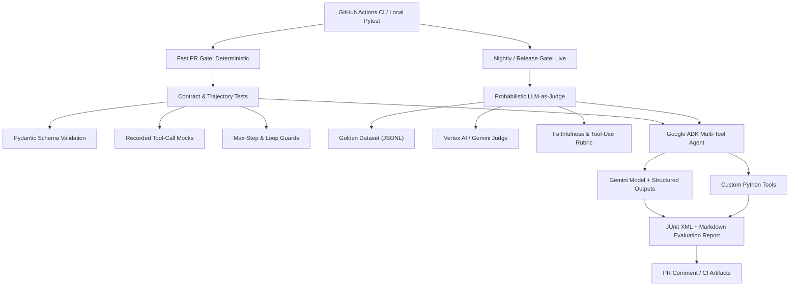

# Hi, I'm Rakesh

**SDET & AI Quality Engineer | Bengaluru, India**

I build automated testing frameworks, evaluation harnesses, and CI/CD quality gates for software systems and LLM-powered agents. Currently exploring AI agent testing with **Google ADK, Gemini API, and Vertex AI**.

### Technical Focus Areas
- **Agentic Workflow Testing:** Tool-call validation, multi-step workflow evaluation, and schema validation using `pytest` and `Pydantic`.
- **LLM Evaluation:** Prompt regression, hallucination detection, and response quality evaluation.
- **Test Infrastructure:** Mocking, synthetic test datasets, and GitHub Actions CI/CD automation.

### Featured Open-Source Work
- **[Gemini ADK Agent Testing](https://github.com/YOUR_USERNAME/gemini-adk-agent-testing)** — A Python testing framework for multi-tool AI agents built with Google ADK and the Gemini API.

### Connect
- **Location:** Bengaluru, India
- **LinkedIn:** (https://www.linkedin.com/in/rakesh-k-142ab483/)

## Architecture

